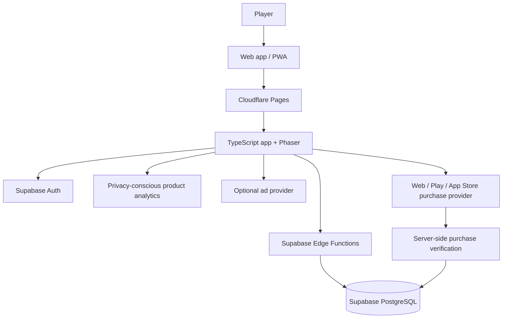

# Grid Rivals — High-Level Design

**Status:** Proposed architecture baseline  
**Scope:** Existing browser game, future PWA/native packaging, scalable backend and monetisation  
**Principle:** Evolve the existing product incrementally; do not rewrite or introduce infrastructure before usage justifies it.

## 1. Product goals

- Keep the core strategy game free and fair.
- Support desktop and mobile browsers from one codebase.
- Make scores, progression, achievements and purchases server-authoritative.
- Keep early operating costs near zero while accepting that free tiers have availability and quota limits.
- Add monetisation without pay-to-win mechanics.
- Preserve existing player identities and historical scores during migrations.

## 2. Current baseline

| Layer | Current technology | Decision |
|---|---|---|
| Game rendering | Phaser 4 | Retain |
| Language/build | TypeScript, Vite | Retain |
| Hosting/CDN | Cloudflare Pages | Retain |
| Authentication/database | Supabase Auth and PostgreSQL | Retain |
| Trusted backend | Supabase Edge Functions | Retain |
| Competitive verification | Server-created runs and transcript replay | Retain and test |
| Mobile distribution | Browser today | PWA first; Capacitor later |
| Monetisation | Not implemented | Design interfaces now; integrate after validation |

The existing backend includes profiles, scores, game runs, player progress and achievement awards. Historical scores predating server verification are retained as unverified and must not be represented as verified competitive results.

## 3. Target architecture

### Frontend responsibilities

- Render screens, board, animations and audio.
- Handle touch, mouse and keyboard input.
- Maintain ephemeral in-progress gameplay state.
- Call backend services for game runs, submissions, profile and leaderboard data.
- Display server-authoritative progress and entitlements.
- Store only non-authoritative preferences and short-lived caches locally.

### Backend responsibilities

- Authenticate callers and derive identity from verified auth tokens.
- Create and expire game runs.
- Verify submitted transcripts by replaying the versioned rules.
- Atomically record scores and award progression.
- Serve leaderboard and player summary data.
- Verify store transactions before granting premium entitlements.
- Apply input validation, rate limits and idempotency to sensitive operations.

The current replay verification proves that a submitted transcript is legal under the game rules. It does not prove a human played the game or eliminate bots.

## 4. Code boundaries

Refactor incrementally toward these boundaries; do not move every file in one change.

- `app/`: startup, routing and application configuration.
- `game/`: Phaser scene, game controller, rendering, input and audio.
- `screens/`: menu, statistics, achievements and leaderboard presentation.
- `services/`: auth, game-run, player, leaderboard and purchase API clients.
- `storage/`: local preferences and cache only.
- `monetization/`: provider interfaces and UI integration.
- `shared/game/`: pure, versioned game rules and types shared by client and verifier.
- `supabase/functions/`: trusted server endpoints and backend-only helpers.

The current `src/main.ts` is a large composition point. Split by responsibility while preserving URLs, gameplay rules, accessibility and existing user flows.

## 5. Data ownership

| Data | Authority | Browser role |
|---|---|---|
| Scores and verification status | PostgreSQL | Display/cache |
| XP, levels and progression | PostgreSQL | Display/cache |
| Achievement awards | PostgreSQL | Display/cache |
| Display name | PostgreSQL | Form/cache |
| Premium entitlements and purchases | PostgreSQL after provider verification | Display only |
| Sound and presentation preferences | Device/browser | Persist locally |
| Temporary board and animation state | Active client session initially | In-memory |
| Leaderboard responses | PostgreSQL | Short-lived cache |

Do not import client-controlled legacy XP or achievements into authoritative server progression. Preserve legacy local information until a deliberate migration or retirement strategy is approved. Never silently overwrite server progress from local storage.

## 6. Database evolution

Retain the current five principal tables:

- `grid_rivals_profiles`
- `grid_rivals_scores`
- `grid_rivals_game_runs`
- `grid_rivals_player_progress`
- `grid_rivals_achievement_awards`

Possible later tables, only when features are approved:

- `grid_rivals_entitlements`: active premium rights.
- `grid_rivals_purchases`: provider transaction references and verification state.
- `grid_rivals_cosmetics`: catalogue of non-competitive items.
- `grid_rivals_player_inventory`: owned cosmetics.
- `grid_rivals_seasons` and `grid_rivals_season_progress`: time-limited competitions.

All schema changes must be additive where practical, reviewed, tested on a non-production environment, and accompanied by rollback/recovery notes. No new monetisation tables are required now.

## 7. Identity and account recovery

Anonymous sign-in is suitable for frictionless first play, but a browser-persisted anonymous identity can be lost when browser storage is cleared.

Plan optional account linking (email and/or supported OAuth provider) before a native launch. Linking must preserve the existing auth user ID and its scores/progression; do not create a second profile and attempt a lossy merge. Test account linking and recovery before release.

## 8. Mobile distribution

1. Responsive web: optimise canvas, menus, safe areas, touch targets, keyboard/accessibility and orientation.
2. PWA: add manifest, icons and carefully scoped static-asset caching. Competitive verified play requires connectivity.
3. Native packaging: evaluate Capacitor only after mobile usage and retention justify store maintenance.

Keep one game implementation. Native wrappers should add platform capabilities rather than fork gameplay.

## 9. Monetisation principles

Keep competitive outcomes skill-based. Do not sell score advantages, leaderboard positions or gameplay power.

Potential revenue streams, in order:

1. Optional rewarded ads at player-chosen natural breaks (for example, practice hints or cosmetic rewards).
2. Cosmetic one-time purchases (themes, tile skins, profile frames and celebration effects).
3. A one-time ad-free option.
4. Subscription only when recurring benefits justify recurring billing (advanced statistics, cosmetic drops, seasonal content).
5. Sponsored challenges after the audience is large enough.

Ads must never interrupt an active match. Apply frequency caps and respect consent, age, privacy and regional rules. Purchases of digital goods inside native apps must follow the applicable Apple/Google billing rules. Verify all transactions server-side and make processing idempotent.

## 10. Analytics and success measures

Start with minimal, privacy-conscious event measurement. Avoid collecting personal data that is not needed.

Measure:
- game starts and completions;
- daily challenge participation;
- sessions and games per active player;
- D1 and D7 return rates;
- mobile versus desktop usage;
- rewarded-ad opt-in and completion;
- purchase conversion, refunds and subscription retention if applicable.

Do not optimise monetisation before validating repeat play and retention.

## 11. Cost and scaling strategy

Initial target: use existing Cloudflare Pages and Supabase free tiers during validation, with alerts/monitoring for quotas and availability. Free tiers are not a production uptime guarantee; Supabase Free projects may pause after inactivity and have limited backup/operational features.

Cost controls:
- Static hosting and CDN for the frontend.
- Keep trusted backend operations small and purposeful.
- Avoid polling; use bounded pagination and short-lived caching.
- Index measured query patterns, not speculative ones.
- Expire old unconsumed game runs with a safe scheduled cleanup when needed.
- Set usage alerts and document upgrade triggers.
- Upgrade database/hosting only when actual usage, uptime requirements or quotas demand it.

Do not add microservices, Redis, Kubernetes or a separate application server without measured need.

## 12. Security and operations

- Keep service-role and provider secrets server-side only.
- Enforce RLS and least-privilege grants.
- Validate all inputs at trusted boundaries.
- Rate-limit game-run creation and sensitive actions.
- Use idempotency for score submissions and purchases.
- Version game rules and RNG; retain old verifier support for any still-valid outstanding runs.
- Maintain automated tests for rules, transcript verification and progression.
- Use feature branches, CI/build checks and staged deployments.
- Never merge to production or run destructive database operations without explicit approval.

## 13. Architecture decision summary

| Decision | Direction |
|---|---|
| Rewrite Phaser game | No |
| Replace Supabase or Cloudflare now | No |
| Move to microservices | No |
| Make server progression authoritative | Yes |
| Extract shared game rules | Yes, incrementally |
| Refactor large frontend modules | Yes, incrementally |
| Build PWA | After responsive pass |
| Build native apps now | No |
| Add payments/ads immediately | No; validate engagement first |
